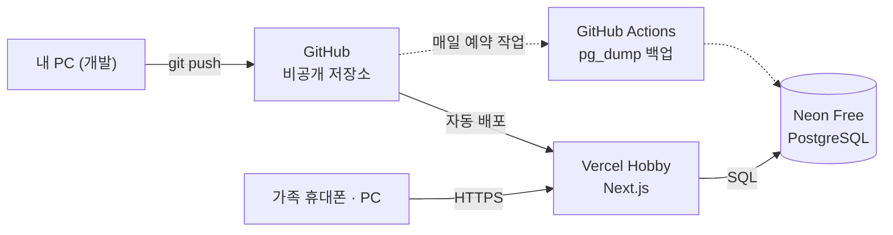

# 02. 기술 스택

> 상태: 초안 v0.2 · 2026-10-03

## 1. 결론: TypeScript 풀스택 (Next.js + PostgreSQL), Vercel + Neon 무료 배포

| 영역 | 선택 | 역할 |
|---|---|---|
| 언어 | **TypeScript** (strict) | 화면·서버·DB 스키마를 한 언어로 |
| 프레임워크 | **Next.js** (App Router) + React | 화면, 서버 컴포넌트(조회), 서버 액션(변경)을 한 프로젝트에서 |
| UI | **Tailwind CSS** + **shadcn/ui** | 모바일 우선 UI를 빠르게. 컴포넌트 소스가 프로젝트에 복사되어 자유롭게 수정 가능 |
| DB | **PostgreSQL** | 관계형 데이터 + `jsonb`(반복 규칙 등) |
| ORM | **Drizzle ORM** + drizzle-kit | TypeScript로 스키마 정의, 타입 안전 쿼리, 마이그레이션 |
| 인증 | **Better Auth** | 이메일/비밀번호, DB 세션, 로그인 시도 제한, 이후 소셜 로그인 확장 |
| 검증 | **Zod** | 폼·서버 액션 입력, `jsonb` 구조를 같은 스키마로 검증 |
| 폼 | React Hook Form | 클라이언트 폼 상태 (Zod 스키마 재사용) |
| 날짜 | date-fns + @date-fns/tz | 가구 시간대(Asia/Seoul) 기준 날짜 계산 |
| 테스트 | Vitest (단위), Playwright (E2E) | 반복 규칙 계산은 단위 테스트, 가입·승인 흐름은 E2E |
| 코드 품질 | ESLint + Prettier | 모듈 간 import 금지 규칙도 ESLint로 강제 |
| 패키지 매니저 | pnpm | |
| 배포 | **Vercel (Hobby)** + **Neon (Free)** | 앱 호스팅 + 관리형 PostgreSQL, 둘 다 무료 |
| 로컬 DB | Docker Compose (PostgreSQL) | Windows에서는 Docker Desktop |

## 2. 선택 이유

**한 사람이 만드는 우리 집 전용 서비스**라는 조건에 맞췄습니다.

- **언어 하나, 저장소 하나.** 화면·서버·DB 스키마의 타입이 이어져 있어서 컬럼을 바꾸면 화면 코드까지 컴파일 에러로 알려 줍니다. 1인 개발에서 가장 큰 생산성 요인입니다.
- **별도 API 서버가 필요 없음.** 조회는 서버 컴포넌트가 DB를 직접 읽고, 변경은 서버 액션으로 처리합니다. REST API 설계와 클라이언트 상태 동기화 부담이 줄어듭니다.
- **무료 배포가 쉬움.** Next.js는 Vercel 무료 플랜에 그대로 올라가고, 요청이 없을 때는 서버가 돌지 않습니다. 상시 실행 서버가 필요한 Spring Boot보다 무료로 운영하기 훨씬 쉽습니다.
- **PostgreSQL.** 할 일·식단·레시피는 관계형이 자연스럽고, 반복 규칙처럼 형태가 바뀌는 값은 `jsonb`로 담을 수 있습니다. 대시보드 집계도 SQL로 충분합니다.
- **Drizzle.** SQL에 가까운 문법이라 나중에 대시보드 집계 쿼리를 쓰기 편하고 런타임이 가볍습니다.
- **Better Auth.** 직접 만들면 위험한 부분(비밀번호 해싱, 세션, CSRF, 시도 횟수 제한)을 맡기면서도 사용자·세션 테이블은 우리 DB에 그대로 둡니다.

## 3. Java 개발자를 위한 대응표

Spring에서 쓰던 개념이 이 프로젝트에서 어디에 해당하는지 정리했습니다.

| Spring (Java) | 이 프로젝트 |
|---|---|
| `@Controller` / `@PostMapping` | 서버 액션 (`actions.ts`) |
| `@Service` | `service.ts` |
| `@Transactional` | `db.transaction(async (tx) => { … })` |
| JPA `@Entity` | Drizzle 테이블 정의 (`schema.ts`) |
| Repository / QueryDSL | `queries.ts` (Drizzle 쿼리 빌더) |
| Bean Validation (`@NotNull`, `@Size`) | Zod 스키마 (`validators.ts`) |
| Spring Security | Better Auth + `requireMember()` |
| Flyway / Liquibase | drizzle-kit 마이그레이션 |
| Thymeleaf / JSP | React 서버 컴포넌트 |
| JUnit / Mockito | Vitest |
| Gradle / Maven | pnpm + `package.json` |
| `application.yml` | `.env.local` / Vercel 환경 변수 |
| `enum Role { OWNER, ADMIN }` | 유니온 타입 `'owner' \| 'admin' \| 'member'` |

**Java와 다르게 주의할 점**

- **타입은 컴파일할 때만 존재합니다.** 실행 중에는 타입 검사가 없으므로, 외부에서 들어오는 값(폼 입력, DB의 `jsonb`)은 반드시 Zod로 검증합니다.
- **`null`과 `undefined`가 둘 다 있습니다.** DB 값은 `null`, 선택적 필드는 `undefined`로 구분해서 씁니다.
- **DB 호출은 전부 비동기입니다.** `await`를 빠뜨리면 컴파일러와 ESLint가 잡아 주도록 설정합니다.
- **클래스와 DI 컨테이너 대신 함수와 모듈 import를 씁니다.** 서비스는 클래스가 아니라 export된 함수입니다.

## 4. 검토한 대안

| 대안 | 장점 | 고르지 않은 이유 |
|---|---|---|
| React(Vite) + Spring Boot | Java 경험을 바로 활용 | 프로젝트 2개·언어 2개. 상시 실행 JVM 서버가 필요해 무료 호스팅 선택지가 적음 |
| React + FastAPI (Python) | 데이터 분석·AI 연동이 쉬움 | 화면·서버 간 타입 공유가 안 되고 프로젝트가 2개 |
| Next.js + Supabase | 인증·DB·실시간 동기화를 바로 제공 | 특정 서비스 종속, 권한 로직이 DB 정책(RLS)과 앱 코드로 나뉨 |

## 5. 배포: Vercel Hobby + Neon Free

### 5.1 무료 한도 (2026-10 확인, 바뀔 수 있음)

| 서비스 | 무료 한도 | 우리 집 예상 |
|---|---|---|
| [Vercel Hobby](https://vercel.com/docs/plans/hobby) | 개인·비상업 용도. 대역폭 100GB/월, 함수 호출 100만 회/월, Active CPU 4시간/월 | 가족 몇 명이 쓰는 정도는 한도의 아주 작은 일부 |
| [Neon Free](https://neon.com/pricing) | 프로젝트당 저장 공간 0.5GB, 컴퓨트 100 CU-시간/월, 브랜치 10개, 신용카드 불필요. 5분간 요청이 없으면 자동 일시 정지 | 텍스트 위주 데이터라 수년 치도 0.5GB 안에 들어올 것으로 예상 |
| 주소 | `<프로젝트이름>.vercel.app` (HTTPS 자동) | 도메인 구입 불필요 |

### 5.2 주의할 점

- **Vercel Hobby는 개인·비상업 용도 전용**입니다. 우리 집 전용이라 해당됩니다.
- **한도를 넘기면 Vercel 무료 플랜은 추가 구매가 안 되고 기다려야 합니다.** 가족 사용량으로는 가능성이 낮지만, 운영 안정화 단계(M5)에서 사용량 화면을 한 번 점검합니다.
- **Neon은 5분간 요청이 없으면 일시 정지됩니다.** 오랜만에 열면 첫 화면이 잠깐 느릴 수 있습니다.
- **Neon 무료 플랜은 복구 기간이 짧습니다.** GitHub Actions 예약 작업으로 매일 `pg_dump` 백업을 따로 받습니다.
- **리전**: Neon은 한국에서 가까운 아시아 리전(예: 싱가포르)을 고르고, Vercel 함수 리전도 같은 곳으로 맞춰 DB 왕복 시간을 줄입니다.
- **DB 연결 방식**: 서비스 계층에서 트랜잭션을 쓰므로, 운영 환경에서는 트랜잭션을 지원하는 연결 방식(Neon 서버리스 드라이버의 WebSocket 풀, 또는 일반 `pg` 드라이버 + Neon 풀링 주소)을 씁니다. HTTP 방식은 여러 쿼리를 묶는 대화형 트랜잭션을 지원하지 않습니다.
- **사진은 DB에 넣지 않습니다** (0.5GB 한도). 사진 기능을 넣을 때 별도 저장소를 검토합니다.

### 5.3 환경

| 환경 | 앱 | DB |
|---|---|---|
| 로컬 개발 | `pnpm dev` | Docker PostgreSQL |
| 미리보기 (PR마다) | Vercel 미리보기 URL | Neon 브랜치 (운영 데이터와 분리) |
| 운영 | `<프로젝트이름>.vercel.app` | Neon 기본 브랜치 |

> GitHub · Vercel · Neon 계정 생성과 서로 연결하는 작업은 직접 하셔야 합니다. M1에서 순서대로 안내합니다.

## 6. 개발 환경 (Windows 11)

- Node.js 최신 LTS, pnpm (`corepack enable`)
- Docker Desktop (로컬 PostgreSQL)
- VS Code + ESLint, Prettier, Tailwind CSS IntelliSense 확장
- 환경 변수: `DATABASE_URL`, `BETTER_AUTH_SECRET`, `BETTER_AUTH_URL`, `SIGNUP_ENABLED`
