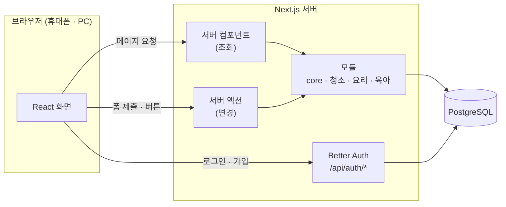
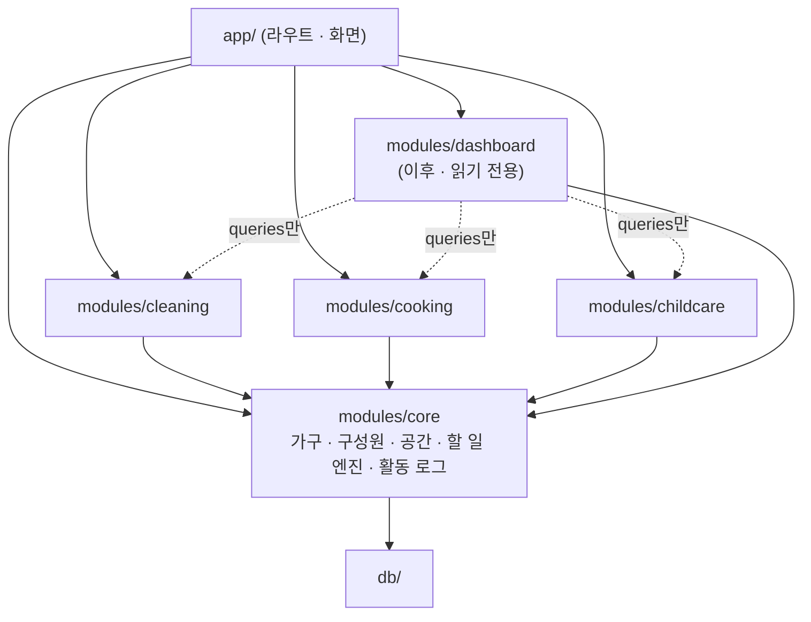

# 03. 아키텍처

> 상태: 초안 v0.2 · 2026-10-03

## 1. 시스템 구성



- Next.js 애플리케이션 하나(모놀리스) + PostgreSQL 하나. 운영은 Vercel + Neon ([02. 기술 스택](02-tech-stack.md) 5절).
- **조회**: 서버 컴포넌트가 모듈의 `queries.ts`를 호출해 DB를 바로 읽고 HTML로 렌더링한다.
- **변경**: 서버 액션(`actions.ts`)이 입력 검증·인가 후 `service.ts`를 호출하고, 바뀐 화면을 재검증(`revalidatePath`)한다.
- **인증**: `/api/auth/*`는 Better Auth 핸들러가 처리한다.

## 2. 폴더 구조

```
household-hub/
├─ docs/                          # 설계 문서
├─ src/
│  ├─ app/                        # 라우트 (화면만, 비즈니스 로직 없음)
│  │  ├─ (auth)/login, signup     # 비로그인 전용
│  │  ├─ pending/                 # 로그인 + 승인 대기
│  │  ├─ (app)/                   # 로그인 + 승인된 구성원
│  │  │  ├─ layout.tsx            # 인증 가드 + 하단 탭/사이드바
│  │  │  ├─ cleaning/
│  │  │  ├─ cooking/
│  │  │  ├─ childcare/            # 지금은 "준비 중" 빈 화면
│  │  │  └─ settings/
│  │  └─ api/auth/[...all]/route.ts
│  ├─ modules/
│  │  ├─ core/
│  │  │  ├─ auth-context.ts       # requireMember()
│  │  │  ├─ household/            # 가구 · 구성원 · 가입 승인
│  │  │  ├─ space/                # 공간
│  │  │  ├─ task/                 # 할 일 엔진 (recurrence.ts + 테스트)
│  │  │  └─ activity/             # logActivity()
│  │  ├─ cleaning/                # 각 모듈은 아래와 같은 구조
│  │  ├─ cooking/
│  │  └─ childcare/               # 지금은 README만
│  │     ├─ components/           # 이 모듈 전용 UI
│  │     ├─ actions.ts            # 서버 액션
│  │     ├─ queries.ts            # 조회 (server-only)
│  │     ├─ service.ts            # 비즈니스 규칙
│  │     ├─ schema.ts             # Drizzle 테이블
│  │     └─ validators.ts         # Zod 스키마
│  ├─ components/ui/              # shadcn/ui 공용 컴포넌트
│  ├─ db/                         # DB 연결, 스키마 모음, migrations/
│  └─ lib/                        # auth.ts, auth-client.ts, date.ts 등
├─ tests/e2e/                     # Playwright
├─ docker-compose.yml
└─ drizzle.config.ts
```

청소 모듈은 core의 공간·할 일 테이블을 사용하므로 자체 `schema.ts`가 비어 있을 수 있다. 육아 모듈은 상세 설계 전까지 빈 틀로 둔다.

## 3. 계층별 책임

| 계층 | 파일 | 하는 일 | 하지 않는 일 |
|---|---|---|---|
| 화면 | `app/**`, `components/` | 렌더링, 사용자 입력 | DB 접근, 권한 판단 |
| 서버 액션 | `actions.ts` | Zod 입력 검증 → `requireMember()` 인가 → 서비스 호출 → 화면 재검증 | 비즈니스 규칙 |
| 조회 | `queries.ts` | 가구 범위로 제한된 읽기 | 쓰기 |
| 서비스 | `service.ts` | 비즈니스 규칙, 트랜잭션, 활동 로그 기록 | 폼·HTTP 처리 |
| 스키마 | `schema.ts`, `validators.ts` | 테이블 정의, 입력·jsonb 구조 정의 | |

서버 액션의 반환 형태는 통일한다.

```ts
type ActionResult<T> =
  | { ok: true; data: T }
  | { ok: false; error: { code: string; message: string; fieldErrors?: Record<string, string> } };
```

## 4. 모듈 의존 규칙



- 청소·요리·육아는 **core에만 의존**한다. 모듈끼리 import하지 않는다 (ESLint `no-restricted-imports`로 강제).
- 모듈 사이 연계가 필요하면(예: 육아의 알레르기 정보를 요리 화면에 표시) 화면(app) 계층에서 두 모듈의 조회를 조합하거나, core에 공통 계약을 둔다.
- 나중에 만들 대시보드는 각 모듈의 `queries.ts`와 활동 로그만 **읽는다**.

## 5. 인증·인가

검사는 세 겹으로 하되, **실제 보안 경계는 3번**이다.

1. **프록시(미들웨어)** — 세션 쿠키가 없으면 `/login`으로 리다이렉트. 빠른 1차 필터일 뿐이다.
2. **`(app)/layout.tsx`** — 서버에서 세션을 검증하고 승인된 구성원인지 확인. 승인 대기면 `/pending`.
3. **모든 서버 액션·조회** — `requireMember()`로 다시 검증. 서버 액션은 화면과 별개로 직접 호출될 수 있는 엔드포인트이므로 레이아웃 검사를 믿지 않는다.

```ts
// modules/core/auth-context.ts
type Role = 'owner' | 'admin' | 'member';

type MemberContext = {
  userId: string;
  memberId: string;
  householdId: string;
  role: Role;
  timezone: string; // 'Asia/Seoul'
};

/** 세션 검증 + 승인된(active) 구성원인지 확인. 실패하면 401/403. minRole이 있으면 역할도 검사 */
export async function requireMember(minRole?: Role): Promise<MemberContext>;
```

**가구 범위 규칙**

- `householdId`는 절대 클라이언트 입력에서 받지 않고 항상 `MemberContext`에서 가져온다.
- 모든 쿼리에 `household_id = ctx.householdId` 조건을 넣는다.
- 다른 가구의 id로 요청하면 '없음(404)'으로 응답한다 (존재 여부를 노출하지 않음).

## 6. 공통 엔진 (core)

### 6.1 할 일 엔진

반복되는 일을 관리하는 공통 엔진이다. **청소가 첫 사용처**이고, 이후 다른 모듈(육아 등)에서 반복되는 일이 필요하면 같은 엔진을 쓴다. 대시보드에서 "오늘 할 일 전체"를 모으기도 쉬워진다.

**반복 규칙** (`task.recurrence`, jsonb)

```ts
// modules/core/task/recurrence.ts
export type Weekday = 0 | 1 | 2 | 3 | 4 | 5 | 6; // 0 = 일요일

export type Recurrence =
  | { type: 'once'; dueDate: string | null }  // 1회성, 기한은 선택 (YYYY-MM-DD)
  | { type: 'daily' }
  | { type: 'weekly'; weekdays: Weekday[] }    // [2, 5] = 화·금
  | { type: 'monthly'; day: number }          // 1~31, 없는 날짜는 그 달 말일
  | { type: 'every_n_days'; days: number };   // 완료일 기준 N일 뒤

/** 할 일 생성·규칙 변경 시 첫 예정일 */
export function firstDueDate(r: Recurrence, startDate: string): string | null;

/** 완료 후 다음 예정일. null이면 더 이상 예정 없음 */
export function nextDueDate(r: Recurrence, dueDate: string | null, completedOn: string): string | null;

/** 기간 안의 발생일 목록 (달력 · 일정 표시용) */
export function occurrencesBetween(r: Recurrence, from: string, to: string): string[];
```

**두 가지 반복 방식**

| 방식 | 규칙 | 맞는 일 | 다음 예정일 |
|---|---|---|---|
| 일정 기준 | `daily` · `weekly` · `monthly` | 요일이 정해진 일 (분리수거, 화장실 청소) | `max(예정일, 완료일)` **다음**의 첫 발생일 |
| 완료 기준 | `every_n_days` | 주기만 중요한 일 (이불 빨래, 필터 교체) | 완료일 + N일 |
| 1회성 | `once` | 한 번만 할 일 | 없음 (완료 처리) |

**예시** — 2026년 10월 기준

| 할 일 | 규칙 | 예정일 | 실제 완료 | 다음 예정일 | 설명 |
|---|---|---|---|---|---|
| 화장실 청소 | 매주 토 | 10/10 (토) | 10/10 | 10/17 | 제때 |
| 화장실 청소 | 매주 토 | 10/10 (토) | 10/8 (목) | 10/17 | 이번 회차를 미리 함 |
| 화장실 청소 | 매주 토 | 10/10 (토) | 10/13 (화) | 10/17 | 밀린 회차는 쌓이지 않음 |
| 분리수거 | 매주 화·금 | 10/6 (화) | 10/6 | 10/9 (금) | |
| 이불 빨래 | 14일마다 | 10/10 | 10/13 | 10/27 | 완료일 기준 |
| 냉장고 정리 | 매월 31일 | 10/31 | 10/31 | 11/30 | 31일이 없는 달은 말일 |

**상태 분류** (가구 시간대의 '오늘' 기준)

| 상태 | 조건 |
|---|---|
| 밀림 | `next_due_date < 오늘` |
| 오늘 | `next_due_date = 오늘` |
| 이번 주 | `오늘 < next_due_date ≤ 오늘 + 6일` |
| 나중 | 그 이후 |
| 기한 없음 | 1회성 + 기한 없음 + 미완료 |
| 완료됨 | 1회성 + 완료 |

**완료 취소**: 완료 기록(`task_completion.due_date`)에 완료 당시 예정일을 저장해 두고, 취소하면 그 값으로 `next_due_date`를 되돌린다. MVP에서는 가장 최근 완료 1건만 취소할 수 있다.

**구현 방식**: 반복 회차를 미리 만들어 두지 않고, 할 일에 `next_due_date` 하나만 유지한다. 단순하고 규칙 변경이 쉽다. 대신 "놓친 회차 목록"은 만들 수 없는데, 가정용으로는 "며칠 밀렸는지"면 충분하다고 판단했다.

### 6.2 활동 로그

모든 모듈의 주요 행동을 `activity_log`에 시간순으로 쌓는다. 대시보드의 "최근 활동" 피드와 구성원별 기여 집계의 재료다.

```ts
await logActivity(tx, ctx, {
  module: 'cleaning',
  action: 'task.completed',
  target: { type: 'task', id: task.id },
  payload: { title: '화장실 청소', completedByName: '아빠' },
});
```

- 서비스 계층에서 본 작업과 **같은 트랜잭션** 안에서 기록한다.
- `payload`에 제목 등 표시용 정보를 복사해 둔다. 원본이 삭제돼도 피드는 그대로 보인다.
- `action` 이름은 `<대상>.<과거형 동사>` (`task.completed`, `shopping_item.checked`, `member.joined`).
- 정확한 통계(예: 하루 수면 총량)는 활동 로그가 아니라 각 모듈의 원본 테이블에서 계산한다.

## 7. 공통 규칙

| 항목 | 규칙 |
|---|---|
| ID | UUID v7 (시간순 정렬 가능), 앱에서 생성 |
| 시각 | `timestamptz`로 저장, 화면에는 가구 시간대로 표시 |
| 날짜 | 예정일·식단 날짜처럼 시각이 없는 값은 `date`. '오늘'은 항상 가구 시간대 기준으로 계산 |
| 삭제 | 주요 엔티티(공간, 할 일, 레시피)는 `archived_at`으로 보관. 기록성 데이터(완료 기록 등)는 실수 정정용으로 실제 삭제 |
| 이름 | DB는 snake_case, TypeScript는 camelCase (Drizzle casing 옵션) |
| 열거값 | PostgreSQL enum 대신 `text` + Zod 검증 (값 추가 시 마이그레이션 부담 감소) |

## 8. 화면 구조

| 경로 | 화면 |
|---|---|
| `/login`, `/signup` | 로그인, 회원가입 |
| `/pending` | 가입 승인 대기 안내 |
| `/cleaning/**` | 청소 ([모듈 문서](modules/cleaning.md)) |
| `/cooking/**` | 요리 ([모듈 문서](modules/cooking.md)) |
| `/childcare` | 육아 — 지금은 빈 화면 ([모듈 문서](modules/childcare.md)) |
| `/settings/profile`, `/settings/household` | 내 정보, 가구·구성원 관리 |

- **모바일**: 하단 탭 `[청소] [요리] [육아] [설정]`. 대시보드가 생기면 맨 앞에 `[홈]`을 추가한다.
- **PC**: 같은 메뉴를 왼쪽 사이드바로.
- **로그인 후 첫 화면**: 대시보드 전까지는 `/cleaning`.
- 구성원마다 색을 정해 담당자·기록자를 칩 색으로 구분한다. 다크 모드 지원.

## 9. 오류 처리

- 입력 오류는 서버 액션이 `fieldErrors`로 돌려주고 폼 필드 아래에 표시한다.
- 예상하지 못한 오류는 라우트의 `error.tsx`에서 처리하고 서버 로그에 남긴다.
- 체크·완료 같은 잦은 동작은 낙관적 업데이트로 즉시 반영하고, 실패하면 되돌리며 알린다.
