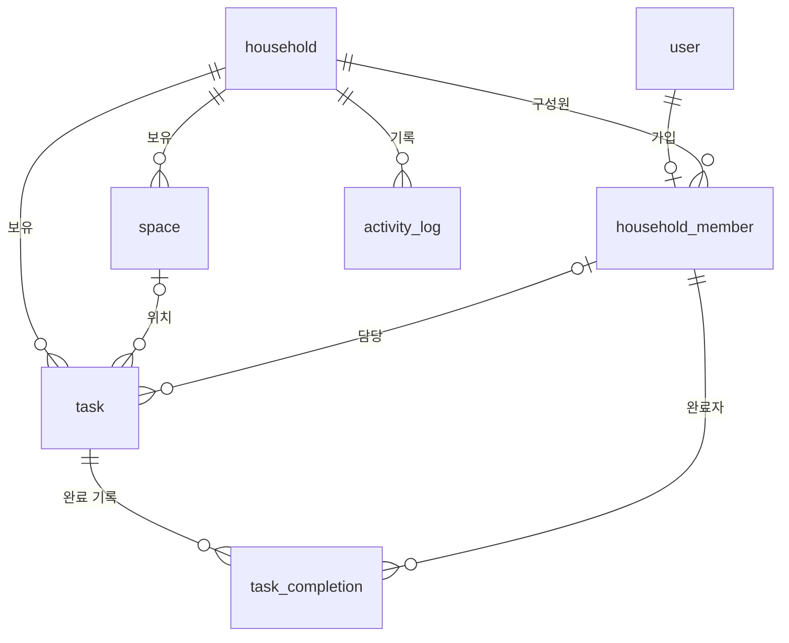
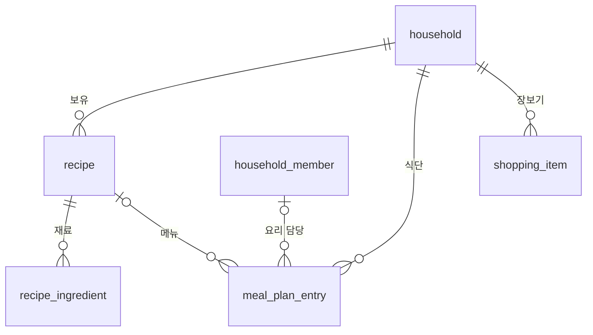
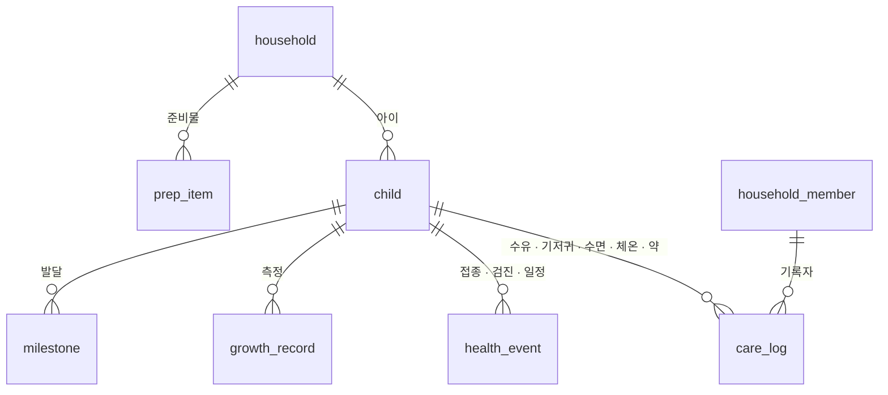

# 04. 데이터 모델

> 상태: v0.5 (M4-1 구현 반영) · 2026-10-12 · DB: PostgreSQL (운영: Neon)

## 1. 공통 규칙

- 모든 테이블은 `id`(uuid v7, PK), `created_at`, `updated_at`(timestamptz)을 가진다. **아래 표에서는 생략한다.**
  - 예외: Better Auth 테이블은 Better Auth 규칙을 따른다 (`user.id`는 text). `activity_log`는 추가만 하므로 `updated_at`이 없다.
- 가구 소유 데이터에는 `household_id`를 둔다. 부모를 통해서만 읽는 하위 행(`recipe_ingredient`)만 예외.
  - 우리 집 전용이라 가구는 1개뿐이지만, 이 규칙을 지키면 권한 검사가 한 가지 방식으로 통일되고 나중에 확장하기도 쉽다.
- `*_member_id`는 `user`가 아니라 `household_member.id`를 가리킨다.
- 열거값은 `text` + 앱의 Zod 검증으로 관리한다.
- `archived_at`이 있는 테이블은 삭제 대신 보관한다.

## 2. 인증 (Better Auth 관리)

| 테이블 | 내용 |
|---|---|
| `user` | id, name, email(unique), email_verified, image |
| `session` | 세션 토큰, 만료 시각, user_id, IP · User-Agent |
| `account` | 로그인 수단별 정보. 이메일 가입은 비밀번호 해시가 여기 저장 |
| `verification` | 인증 토큰 (현재는 거의 쓰지 않음) |
| `rate_limit` | 로그인 · 가입 시도 횟수 제한 기록. 서버리스(Vercel)에서도 동작하도록 메모리 대신 DB에 저장 |

정의: `src/modules/core/auth-schema.ts`. Better Auth 1.7 기본 스키마와 필드 이름을 똑같이 맞추고, 시각만 프로젝트 규칙대로 `timestamptz`로 둔다. Better Auth를 올릴 때 필드가 바뀌었는지 확인한다.

## 3. Core — 가구 · 공간 · 할 일 · 활동 로그

### household — 가구

| 컬럼 | 타입 | 제약 | 설명 |
|---|---|---|---|
| name | text | not null, 기본 `'우리집'` | 가구 이름 |
| timezone | text | not null, 기본 `'Asia/Seoul'` | '오늘' 계산 기준 |

**1행만 존재한다.** 첫 가입자가 생길 때 만들어진다.

### household_member — 구성원

| 컬럼 | 타입 | 제약 | 설명 |
|---|---|---|---|
| household_id | uuid | FK, not null | |
| user_id | text | FK → user.id, unique, not null | 1인 1가구 |
| status | text | not null | `pending`(승인 대기) · `active` · `removed`(내보냄) |
| role | text | not null, 기본 `member` | `owner` · `admin` · `member`. 승인할 때 지정 |
| display_name | text | not null | 가구 안에서 부르는 이름 (엄마, 아빠, 할머니). 기본값 = 가입 이름 |
| color | text | not null | 담당자 칩 색 (예: `#F97316`) |
| approved_at | timestamptz | null | 승인 시각 |
| must_change_password | boolean | not null, 기본 false | 관리자가 임시 비밀번호를 발급하면 true → 다음 로그인 때 변경 화면으로 |

- 내보낸 구성원(`removed`)이 남긴 기록의 작성자 표시는 그대로 유지한다.
- 가입 · 승인 흐름은 [05. 인증 · 가구](05-auth-household.md) 참고.

### space — 공간

| 컬럼 | 타입 | 제약 | 설명 |
|---|---|---|---|
| household_id | uuid | FK, not null | |
| name | text | not null | 거실, 주방, 욕실 … |
| icon | text | null | 이모지 |
| sort_order | int | not null | |
| archived_at | timestamptz | null | |

가구가 만들어질 때 기본 공간을 함께 만든다: 거실 · 주방 · 욕실 · 침실 · 아이방 · 현관 · 베란다 · 다용도실.
보관하면 그 공간을 가리키던 할 일의 `space_id`를 null('공간 없음')로 바꾼다. 보관하지 않은 공간끼리는 이름이 겹치지 않게 앱에서 검사한다.

### task — 할 일 (공통 엔진)

| 컬럼 | 타입 | 제약 | 설명 |
|---|---|---|---|
| household_id | uuid | FK, not null | |
| module | text | not null | `cleaning` (이후 다른 모듈) |
| space_id | uuid | FK, null | |
| title | text | not null | |
| note | text | null | |
| recurrence | jsonb | not null | 반복 규칙 — [03. 아키텍처](03-architecture.md) 6.1절 |
| start_date | date | not null | 첫 예정일 계산 기준 |
| next_due_date | date | null | 다음 예정일. 1회성 완료 · 기한 없는 1회성이면 null |
| assignee_member_id | uuid | FK, null | null = 누구나 |
| estimated_minutes | int | null | 예상 소요 시간 (분담 집계용) |
| last_completed_at | timestamptz | null | |
| created_by_member_id | uuid | FK, not null | |
| archived_at | timestamptz | null | |

- index `(household_id, module, next_due_date) WHERE archived_at IS NULL`
- 정의: `src/modules/core/schema.ts`, 마이그레이션 `0002_tasks.sql`
- 구성원을 내보내면 그 사람이 담당하던 할 일의 `assignee_member_id`를 null(누구나)로 바꾼다.

### task_completion — 완료 기록

| 컬럼 | 타입 | 제약 | 설명 |
|---|---|---|---|
| household_id | uuid | FK, not null | |
| task_id | uuid | FK, not null | |
| completed_by_member_id | uuid | FK, not null | 실제로 한 사람 (다른 사람이 대신 체크 가능) |
| completed_at | timestamptz | not null | |
| due_date | date | null | 완료 당시 예정일. 완료 취소 시 복원, 일찍/늦게 완료 통계 |
| note | text | null | |

- index `(task_id, completed_at DESC)`, `(household_id, completed_at)`

### activity_log — 활동 로그

| 컬럼 | 타입 | 제약 | 설명 |
|---|---|---|---|
| household_id | uuid | FK, not null | |
| actor_member_id | uuid | FK, null | null = 시스템 |
| module | text | not null | `core` · `cleaning` · `cooking` · `childcare` |
| action | text | not null | `task.completed` 형식 |
| target_type | text | null | `task`, `recipe` … |
| target_id | text | null | 대상 id (user id는 text라서 text로 통일) |
| payload | jsonb | not null | 표시용 스냅샷 (제목 등) |

- index `(household_id, created_at DESC)`

## 4. 요리

### recipe — 레시피

| 컬럼 | 타입 | 제약 | 설명 |
|---|---|---|---|
| household_id | uuid | FK, not null | |
| title | text | not null | |
| description | text | null | |
| servings | int | null | 기준 인분 |
| cook_minutes | int | null | 조리 시간 |
| steps | jsonb | not null, 기본 `[]` | 조리 순서 (`string[]`) |
| tags | text[] | not null, 기본 `{}` | 국 · 반찬 · 메인 · 간식 … |
| source_url | text | null | 출처 (블로그, 유튜브) |
| image_url | text | null | (이후 — 아직 만들지 않음. 사진은 DB가 아닌 별도 저장소) |
| created_by_member_id | uuid | FK, not null | |
| archived_at | timestamptz | null | |

### recipe_ingredient — 재료

| 컬럼 | 타입 | 제약 | 설명 |
|---|---|---|---|
| recipe_id | uuid | FK (cascade), not null | |
| name | text | not null | 양파 |
| quantity | numeric | null | 숫자로 표현되는 양 (0.5, 200) |
| unit | text | null | g, 개, 큰술, 컵 … |
| note | text | null | '약간', '취향껏', '다진 것' |
| sort_order | int | not null | |

### meal_plan_entry — 식단 칸의 메뉴

한 끼에 메뉴가 여러 개(밥 · 국 · 반찬)일 수 있어서 메뉴 1개 = 1행이다.

| 컬럼 | 타입 | 제약 | 설명 |
|---|---|---|---|
| household_id | uuid | FK, not null | |
| date | date | not null | |
| meal_type | text | not null | `breakfast` · `lunch` · `dinner` · `snack` |
| kind | text | not null, 기본 `home` | `home` · `eating_out` · `delivery` |
| title | text | not null | 표시 이름. 레시피 선택 시 레시피 제목을 복사 |
| recipe_id | uuid | FK, null | 직접 입력이면 null |
| cook_member_id | uuid | FK, null | 요리 담당 |
| note | text | null | |
| sort_order | int | not null | 한 끼 안의 순서 |

- index `(household_id, date)`

### shopping_item — 장보기 항목

| 컬럼 | 타입 | 제약 | 설명 |
|---|---|---|---|
| household_id | uuid | FK, not null | |
| name | text | not null | |
| quantity | numeric | null | |
| unit | text | null | |
| category | text | null | 채소·과일 / 육류·해산물 / 유제품·계란 / 양념·가공 / 생활용품 / 기타 |
| note | text | null | |
| source | text | not null | `manual` · `meal_plan` |
| is_checked | boolean | not null, 기본 false | |
| checked_by_member_id | uuid | FK, null | |
| checked_at | timestamptz | null | |
| cleared_at | timestamptz | null | '정리' 후 목록에서 숨김. 구매 이력은 보존 (이후 자주 사는 품목 추천) |
| created_by_member_id | uuid | FK, not null | |

- index `(household_id) WHERE cleared_at IS NULL`

## 5. 육아

[모듈: 육아](modules/childcare.md). M4-1에서 child · health_event · growth_record · prep_item을 만들었다 (정의: `src/modules/childcare/schema.ts`, 마이그레이션 `0004_childcare_prep_schedule.sql`). care_log · milestone은 M4-2에서 만든다.

### child — 아이

| 컬럼 | 타입 | 제약 | 설명 |
|---|---|---|---|
| household_id | uuid | FK, not null | |
| name | text | not null | 태명 → 태어나면 이름으로 바꿀 수 있음 |
| due_date | date | null | 출산 예정일 |
| birth_date | date | null | null이면 '출산 전' |
| sex | text | null | `female` · `male` · null(모름 · 비공개) |
| sort_order | int | not null | 아이 고르기 순서 |
| archived_at | timestamptz | null | |

### care_log — 신생아 기록

| 컬럼 | 타입 | 제약 | 설명 |
|---|---|---|---|
| household_id | uuid | FK, not null | |
| child_id | uuid | FK (cascade), not null | |
| type | text | not null | `feeding` · `diaper` · `sleep` · `temperature` · `medicine` |
| started_at | timestamptz | not null | 기록 시각 (타이머는 시작 시각) |
| ended_at | timestamptz | null | 수면 · 직수만. null이면 진행 중 |
| details | jsonb | not null, 기본 `{}` | 종류별 내용 (아래) |
| note | text | null | |
| recorded_by_member_id | uuid | FK, not null | |

`details` (Zod로 검증):

| type | details |
|---|---|
| feeding | `{ method: 'breast', side: 'left' \| 'right' \| 'both' }` · `{ method: 'pumped' \| 'formula', amountMl: number }` |
| diaper | `{ kind: 'wet' \| 'dirty' \| 'both' }` |
| sleep | `{}` |
| temperature | `{ celsius: number }` (34.0~42.0) |
| medicine | `{ name: string, dose: string \| null }` |

- index `(child_id, started_at DESC)` — 하루 타임라인 · 마지막 수유
- 부분 index `(child_id, type) WHERE ended_at IS NULL AND type IN ('sleep', 'feeding')` — 진행 중 타이머 (종류별 하나는 앱에서 보장)

### health_event — 건강 · 일정

| 컬럼 | 타입 | 제약 | 설명 |
|---|---|---|---|
| household_id | uuid | FK, not null | |
| child_id | uuid | FK (cascade), not null | |
| kind | text | not null | 표준: `vaccination` · `checkup` · `admin`(행정) · `celebration`(기념일). 직접 추가: `prenatal`(산부인과) · `visit`(병원 방문) · `vaccination` · `appointment`(그 밖의 일정) |
| title | text | not null | 'DTaP 1차', '산부인과 정기검진' |
| standard_code | text | null | 표준 일정이면 코드 ('dtap-1'). 아이마다 unique |
| due_date | date | null | 권장 시작일 · 예정일 |
| due_until | date | null | 권장 마지막 날 (기간이 있는 일정) |
| scheduled_at | timestamptz | null | 예약 시각 (선택). 날짜는 due_date, 시각을 넣었을 때만 due_date + 시각을 가구 시간대로 저장 |
| place | text | null | 병원 이름 등 |
| done_on | date | null | 한 날 |
| done_by_member_id | uuid | FK, null | 기록한 사람 |
| dismissed_at | timestamptz | null | 표준 일정 '해당 없음' (다시 만들지 않음) |
| note | text | null | 백신 이름 · 로트 번호, 증상 · 처방 |

- unique `(child_id, standard_code)`
- index `(child_id, due_date)`

### growth_record — 성장 측정

| 컬럼 | 타입 | 제약 | 설명 |
|---|---|---|---|
| household_id | uuid | FK, not null | |
| child_id | uuid | FK (cascade), not null | |
| measured_on | date | not null | |
| weight_kg | numeric(5,2) | null | |
| height_cm | numeric(4,1) | null | |
| head_cm | numeric(4,1) | null | 셋 중 하나 이상 (check `growth_record_has_value`) |
| note | text | null | |
| recorded_by_member_id | uuid | FK, not null | |

### milestone — 발달 기록

| 컬럼 | 타입 | 제약 | 설명 |
|---|---|---|---|
| household_id | uuid | FK, not null | |
| child_id | uuid | FK (cascade), not null | |
| title | text | not null | '첫 뒤집기' |
| achieved_on | date | not null | |
| note | text | null | |
| recorded_by_member_id | uuid | FK, not null | |

### prep_item — 출산 준비 체크리스트

| 컬럼 | 타입 | 제약 | 설명 |
|---|---|---|---|
| household_id | uuid | FK, not null | 아이와 무관하게 가구 단위 |
| category | text | not null | 수유 · 위생 · 목욕 · 의류 · 침구 · 외출 · 이동 · 입원 · 조리원 가방 · 미리 할 일 · (직접 입력) |
| title | text | not null | |
| quantity | text | null | '4개' 같은 참고용 글 |
| note | text | null | '선물 받음 — 이모' |
| is_done | boolean | not null, 기본 false | |
| done_by_member_id | uuid | FK, null | |
| done_at | timestamptz | null | |
| sort_order | int | not null | |
| created_by_member_id | uuid | FK, not null | |

- 잘못 넣은 항목은 실제로 지운다 (기록이 아니라 목록).
