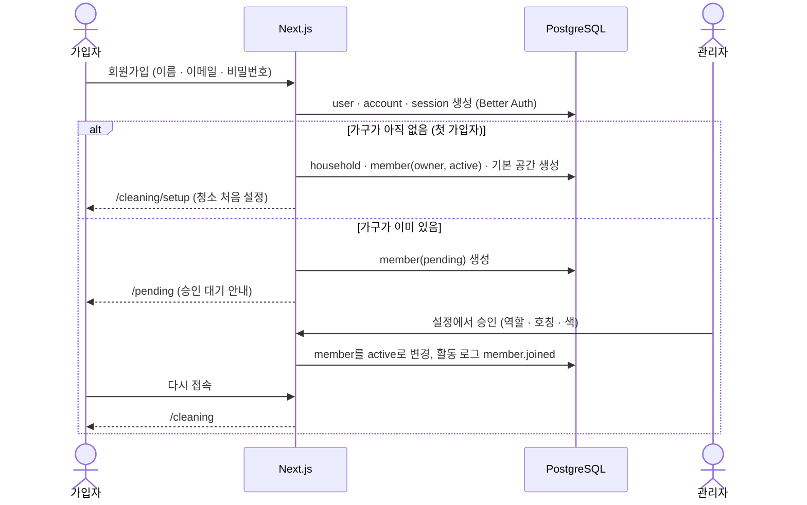

# 05. 인증 · 가구

> 상태: 초안 v0.2 · 2026-10-03 · 사용 테이블: user · session · account (Better Auth), household, household_member

## 1. 기본 방침

- **우리 집 전용.** 앱 안에 가구는 하나뿐이다.
- **초대 코드 없이 누구나 가입할 수 있다.** 대신 **관리자(owner · admin)가 승인해야** 데이터를 볼 수 있다.
  - 클라우드 주소는 인터넷에 열려 있으므로, 모르는 사람이 주소를 알고 가입하더라도 승인 없이는 아무것도 볼 수 없게 한다.
- 처음 가입한 사람이 가구의 **owner**가 된다.

## 2. 기능 목록

| 기능 | MVP 내용 |
|---|---|
| 회원가입 | 이름, 이메일, 비밀번호. 초대 코드 없음 |
| 로그인 / 로그아웃 | 이메일 + 비밀번호, 로그인 30일 유지 |
| 가입 승인 · 거절 | owner · admin이 설정 화면에서 처리. 승인할 때 역할 · 호칭 · 색 지정 |
| 내 정보 | 이름 변경, 비밀번호 변경 |
| 구성원 관리 | 호칭 · 색 · 역할 변경, 내보내기, 비밀번호 초기화(임시 비밀번호 발급) |
| 가입 닫기 | 가족이 모두 가입하면 `SIGNUP_ENABLED=false`로 가입 화면을 닫을 수 있음 |

**이후**: 카카오 · 구글 로그인, 비밀번호 재설정 메일, owner 넘기기 화면.

## 3. 화면

| 경로 | 화면 | 접근 조건 |
|---|---|---|
| `/login` | 로그인 | 비로그인 |
| `/signup` | 회원가입 (가입이 닫혀 있으면 안내 문구) | 비로그인 |
| `/pending` | "관리자 승인을 기다리고 있어요" + 로그아웃 | 로그인 + 승인 대기 |
| `/settings/profile` | 내 정보, 비밀번호 변경, 로그아웃 | 승인된 구성원 |
| `/settings/household` | 가구 이름, 구성원 목록, **승인 대기 목록**, 비밀번호 초기화 | 승인된 구성원 (관리 기능은 admin 이상) |

승인 대기자가 있으면 owner · admin에게 설정 탭 배지와 화면 위쪽 배너("가입 승인 대기 1명")를 보여 준다.

## 4. 흐름

### 4.1 가입 → 승인

- 가입 후 처리는 Better Auth의 사용자 생성 후(after) 훅에서 한다.
- 첫 가입자 판정과 가구 생성은 트랜잭션 + 잠금으로 처리해 가구가 둘 생기지 않게 한다.
- 로그인했는데 구성원 행이 없는 사용자(가입 후 처리 실패 등)는 다음 접속 때 같은 규칙으로 다시 처리한다.
- **승인 화면**에는 이름 · 이메일 · 가입 시각을 보여 줘서 가족인지 확인할 수 있게 한다.
- **거절**하면 그 계정을 삭제한다.

### 4.2 로그인 후 이동

| 상태 | 이동 |
|---|---|
| 승인된 구성원 | 원래 가려던 주소, 없으면 `/cleaning` (대시보드가 생기면 `/`) |
| 승인 대기 | `/pending` |
| 임시 비밀번호로 로그인 | `/settings/profile` (비밀번호 변경 안내) |

`callbackURL`은 **사이트 내부 경로만 허용**한다 (오픈 리다이렉트 방지).

### 4.3 비밀번호를 잊었을 때

메일 발송에는 보내는 도메인이 필요해서, MVP는 **메일 없이** 처리한다.

1. owner · admin이 `/settings/household`에서 해당 구성원의 **[비밀번호 초기화]**를 누른다.
2. 임시 비밀번호가 **한 번만** 화면에 표시된다 → 카카오톡 등으로 직접 전달.
3. 그 사용자의 모든 세션을 끝내고 `must_change_password = true`로 표시한다.
4. 임시 비밀번호로 로그인하면 비밀번호 변경 화면으로 안내한다.

관리자 모두가 비밀번호를 잊은 경우에는 관리 스크립트를 쓴다: 내 PC에서 운영 DB 주소로 `pnpm admin:reset-password <이메일>` 실행.

## 5. 정책

### 5.1 입력 규칙

| 항목 | 규칙 |
|---|---|
| 이름 | 1~20자 |
| 이메일 | 형식 검사, 소문자로 정규화, 중복 불가 |
| 비밀번호 | 8~128자. 문자 조합 강제 대신 길이 중심 |
| 가구 이름 | 1~30자 |
| 호칭 | 1~10자 |

### 5.2 세션

- DB 세션 + `httpOnly` · `Secure` · `SameSite=Lax` 쿠키
- 만료 30일, 사용 중이면 하루 단위로 연장 (가족 앱이라 자주 다시 로그인하지 않게)
- 비밀번호 변경 · 초기화 시 그 사용자의 다른 세션을 끝낸다

### 5.3 이메일 인증

쓰지 않는다. 관리자 승인이 신원 확인 역할을 한다.

## 6. 권한

| 기능 | owner | admin | member |
|---|:-:|:-:|:-:|
| 할 일 완료 · 장보기 체크 | ✅ | ✅ | ✅ |
| 할 일 · 레시피 · 식단 등록 · 수정 | ✅ | ✅ | ✅ |
| 위 항목 보관(삭제) | ✅ | ✅ | 본인이 만든 것만 |
| 공간 관리 | ✅ | ✅ | ❌ |
| 가입 승인 · 거절 | ✅ | ✅ | ❌ |
| 구성원 역할 변경 · 내보내기 | ✅ | ✅ (owner 제외) | ❌ |
| 구성원 비밀번호 초기화 | ✅ | ✅ (owner 포함) | ❌ |
| 가구 이름 수정 | ✅ | ✅ | ❌ |

- 승인 대기자(`pending`)는 `/pending` 화면 외에 아무것도 할 수 없다.
- owner는 정확히 1명. owner 넘기기 화면은 이후에 만든다 (그전에는 관리 스크립트).
- admin이 owner의 비밀번호를 초기화할 수 있게 한 것은 "owner가 비밀번호를 잊어도 배우자가 도와줄 수 있게" 하기 위해서다.

## 7. 보안 체크리스트

- [ ] 비밀번호는 Better Auth 기본 해싱으로만 저장하고, 로그에 남기지 않는다
- [ ] 로그인 · 가입에 시도 횟수 제한을 둔다
- [ ] 로그인 실패 메시지는 "이메일 또는 비밀번호가 올바르지 않습니다"로 통일 (계정 존재 여부 노출 방지)
- [ ] 모든 서버 액션 · 조회에서 `requireMember()`로 **승인된(active) 구성원인지** 확인한다 — 레이아웃 · 프록시 검사만 믿지 않는다
- [ ] `household_id`는 세션에서만 가져오고 클라이언트 입력은 믿지 않는다
- [ ] 임시 비밀번호는 충분히 길고 무작위로 만들고, 화면에 한 번만 보여 준다
- [ ] `callbackURL`은 내부 경로만 허용
- [ ] `BETTER_AUTH_SECRET`은 충분히 긴 무작위 값으로, Vercel 환경 변수에만 저장 (저장소에 커밋 금지)
